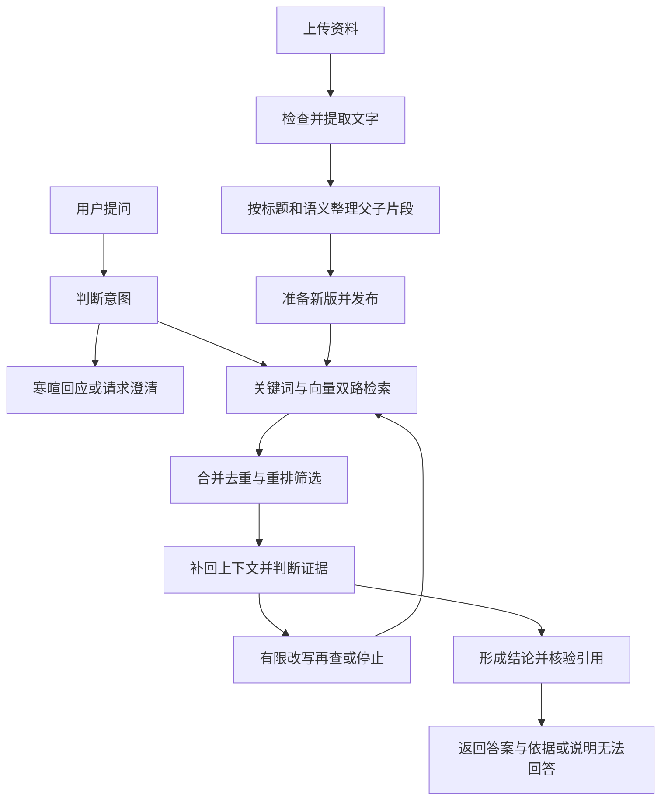

# StudyLens 项目流程讲解：给非技术负责人的学习版

这份文档的目标是让你讲清：资料如何进入知识库，系统为何调用不同工具，什么时候继续查、什么时候停，以及答案如何回到用户面前。

StudyLens 帮用户根据自己的资料找到依据并回答问题。新版加入了持续知识库、混合检索和受限 Agent 流程。当前应将它介绍为“具备这些工程能力的可部署版本”；真实服务联调、质量评测和运行验收完成后，才能进一步说明它适合多少用户、回答有多准确。

## 一、先认识参与者

- **用户**提出问题、上传资料、核对答案；管理者还能更新和删除资料。
- **网页**负责接收操作，展示状态、答案和依据。
- **服务入口**检查访问权限、请求大小和处理预算，把任务交给后面的流程。
- **资料整理工具**从文件中读字、识别图片文字，并保留标题和页码线索。
- **知识库登记簿**保存整理后的文字、来源及当前有效版本；**Milvus**保存用于寻找相近含义的向量和版本标记。
- **检索与重排工具**先广泛找候选资料，再筛掉不合适的片段。
- **Agent**像流程协调员，判断要澄清还是检索，以及是否值得改写后再查。模型给建议，系统限定可执行的动作。
- **回答与审核模型**分别组织结论、核对证据。它们有不同职责，不意味着由不同厂商或不同模型担任。

LangChain 可以理解为模型任务之间的连接工具；Milvus 是向量资料的检索仓库。它们承担不同工作，都不能单独保证答案正确。

## 二、整个流程长什么样

图中的“再查”有次数上限，不能无限循环；完全没有证据时，当前流程会停止并请用户补充资料。

## 三、资料如何进入知识库

**第一步：确认权限和处理方式。**只读凭据可以提问、查看资料列表；管理凭据才可以增删改资料。用户先确认文字会发往配置的向量服务。当前部署以一个工作区为单位，没有把不同组织都放进一个开放共享空间。

**第二步：检查和读字。**系统先检查文件类型和大小，再处理文字。TXT、Markdown 直接读取；DOCX 提取段落、标题和表格；PDF 优先读现成文字，扫描页尝试 OCR；图片先识别文字。OCR 发生在应用服务器，不能把“本地 OCR”理解成资料从未离开用户电脑。

提取失败会提示；PDF 部分页面失败时，会说明缺失页或可能不完整的内容。有可用文字的部分导入仍可能继续，因此管理者必须看警告。公式、手写内容或复杂排版需要对照原文件核对。

**第三步：整理成父块和子块。**父块保留一个标题范围内较完整的上下文；子块负责找到更具体的事实。系统观察相邻文字的含义是否明显变化，再结合长度限制分组。例如“SC 的定义”和“SCL 的候选路径”应保持主题边界。检索先找到小片段，回答时再补回它所属的较完整段落，减少只拿半句话造成的误解。

**第四步：准备完成再发布。**资料使用稳定编号登记。新版先完成整理与向量写入，成功后才切换为当前版本。准备失败时旧版仍可使用，不会把半成品混进正常回答。

相同编号、内容和处理信息重复提交，会识别为未变化，避免重复发布；这叫幂等。更改内容后重新提交才形成新版本。它不会自动监视你电脑上的文件，需要主动导入更新。

删除时先取消资料的可检索资格，再清理旧向量；物理清理暂时失败也不能让旧内容重新参与回答。若超时发生在版本切换附近，应刷新资料列表确认结果，不能仅凭一次报错推断操作一定没生效。

## 四、一个问题怎样变成答案

**先决定是否需要检索。**明确的“你好”“谢谢”可以直接回应。问题指代不清时，例如“这个比另一个好吗”，Agent 应先问清比较对象或指标。知识问题则生成检索方向，改写时应保留原来的实体、数字和条件，不能先编答案再搜索。

**两路一起找候选。**BM25 侧重字词匹配，适合 SC、SCL、BER 等准确术语；向量检索侧重含义相近，帮助找到措辞不同的相关内容。系统合并两路排名并去重，兼顾覆盖范围。命中只表示可能相关，还不是证据充分。

**重排再筛选。**Rerank 把问题与候选短片段一起比较，让更切题的靠前，并过滤低相关片段。它负责减少噪声，不负责创造事实。筛选后补回父块上下文，并避免反复给模型同一段内容。

**判断是否值得再查。**首轮有内容但不足以回答时，Agent 可以提出一个更精确的检索词。如果只是重复原问题，或者新查询没有增加证据，就停止。问题本身不清楚则要求澄清；完全没有材料或仍缺少关键事实则拒答。用户补充说明后，需要重新提出完整问题，当前不把它当作完整多轮聊天记忆。

**逐条形成结论并核对。**模型把答案拆成可核查的结论，每条都要给出证据编号和原文引句。系统检查编号存在、引句确实逐字出现在对应材料中；然后再审核这些材料是否支持结论，是否真正回答了原问题。

若引句只是“实验需记录 FER”，就不能据此声称“FER 等于某个数”。审核未通过，系统不会展示这个未经核对的草稿。返回前还会确认资料版本仍有效；版本变化时提示重新提问。

**最后回到网页。**用户看到答案或澄清、拒答、服务异常提示；成功回答可以展开查看依据、查看本次处理步骤，并下载回答与依据。页面上的答案是查询时的快照，资料后来更新不会自动改写已经显示的旧答案。

## 五、工具调用和任务编排到底是什么

工具调用就是“协调员把一件明确的事交给专门工具”。例如检索工具接收检索词，返回候选资料；重排工具接收问题和候选，返回排序结果。任务编排就是规定它们的先后、输入输出，以及失败后走哪条路。

Agent 只能在约定流程内决策，不能因为资料里写着“忽略规则”，就去执行命令、打开任意网址或访问别人的知识库。更新、删除资料也不交给问答模型自主决定。

当前单次问答最多 **4 次问答模型调用、2 轮检索、3 个不同检索词**。四个模型职责通常是意图判断、证据评估、起草、审核。还有时间和上下文容量预算，防止无意义地持续搜索。

这不代表总共只有四次付费请求：向量和重排服务另外计费；导入时可能分批处理全文。服务超时后不自动重复付费请求。预算能限制后续步骤，但不能保证撤回已经送到服务商的请求。

## 六、资料与问题分别发给谁

- **向量服务**：导入时会接触待整理、待索引的提取文字，可能分批覆盖整份资料；提问时接收问题或改写后的检索词。
- **重排服务**：接收问题和候选片段，比较哪些更相关。
- **问答服务**：意图判断阶段接收问题；后续接收相关上下文，审核阶段还接收草稿结论及引句。它不需要每次读取整个知识库。
- **知识库存储**：服务端登记簿保留整理文字及版本，Milvus 保留向量和对应标记。向量也应按资料权限保护。

服务地址由维护者配置。访问凭据用于控制用户权限，模型服务密钥用于调用外部能力，两者不是同一种东西。把资料从本项目删除，不等于能替外部服务商删除过去收到的请求；实际资料使用方式需要按所选服务商确认。

## 七、用通信笔记走一遍

假设上传的笔记写着：SC 是 successive cancellation，SCL 是 successive cancellation list；SC 保留一条判决路径，SCL 最多保留 L 条候选路径。另有一节说明 CRC 帮助选择最终候选路径，但没有性能曲线。

用户问：“SC 和 SCL 的全称分别是什么？”系统读懂任务后，分别围绕两个术语检索。关键词路找缩写，向量路补充含义相近的内容；合并重排后，带上相关标题上下文交给模型。草稿给出两条结论，各自引用原句；逐字校验和审核通过后返回，用户能展开依据确认。

如果问“这个效果更好吗”，系统需要澄清比较对象、衡量指标或实验条件；如果问“列表 32 提升了多少 dB”，现有材料没有数值，应该说明证据不足，不能把“保留更多路径”改写成某个性能提升。

后来你补充了一份真实实验记录，应使用原资料编号更新。新版向量准备失败时仍检索旧版；新版发布成功后新查询使用新版。若 OCR 漏掉记录数值的页面，警告需要先处理，否则后续问答仍可能没有依据。

## 八、怎样知道真的变好了

自建题集应同时包含直接查找、同义表达、多段证据、歧义、无答案、版本更新和删除后的问题。每题事先写清预期行为及应找到的依据。

召回率看“该找的证据找回多少”；全部证据覆盖看“一题所需材料是否齐全”；答案正确率看“结论是否正确并回答问题”；引用支持率看“引文是否真的支撑结论”；还要检查该澄清时是否澄清、无答案时是否拒答、旧版是否被错误召回。

原 30 题基线单段命中 15/15、多段覆盖 10/10，无答案空检索 0/5。这是检索结果，不是模型答案准确率。关键词出现也不等于语义正确，需要人工核对。

Mock 是测试替身，用于检查流程遇到成功、失败、超时时会怎样。它通过不能算真实模型成绩。新版提升幅度必须在同一题集、明确模型和配置下实际测量；另留一组未参与调参的题，避免只适应熟题。

## 九、对外讲述稿

### 60 秒版本

StudyLens 是一个根据用户资料回答问题的知识库助手。资料上传后先提取文字，再结合标题和语义整理成大小两层片段。问答时，Agent 先判断是否需要查资料或先问清问题，再用关键词和向量两路检索扩大覆盖，通过重排过滤噪声，并补回上下文。每条答案都要附原文引用，系统还检查引用和结论是否对应。资料不足就拒答，搜索无效就停止。知识库更新采用准备好新版再发布的方式，避免用户查到半成品。当前已实现这些流程，真实准确率和部署承载能力仍需要用实际服务、评测集和运行验收证明。

### 3 分钟版本

这个项目解决的是：自己的笔记很多，想快速找到某个问题的依据，而不只是得到一个听起来合理的答案。

第一部分是资料进入知识库。普通文件读文字，图片和扫描页通过 OCR 识别；提取有问题会提示。之后按标题保留较完整的上下文，再根据语义变化整理成适合检索的小片段。向量准备好后，新版才对用户可见；重复提交不会反复发布，删除的资料也不能继续被检索。

第二部分是如何查。Agent 先判断意图，问题不清楚就澄清，需要事实才检索。关键词路善于找缩写和专有术语，向量路补充意思相近但用词不同的内容。两路合并之后，再用重排模型挑出更切题的片段，补回它们的上下文。有内容但不足时可以有限改写再查，最多两轮、三个不同检索词；没有新增证据就停。

第三部分是怎样约束答案。每条结论必须带证据编号和原文引句，先检查引句真实存在，再审核是否支持结论、是否回答了问题。因此，笔记只有 SC 和 SCL 的定义，就不能凭空回答某次实验提升多少 dB。审核失败或者资料缺失时，系统会说明无法回答。

最后，网页把答案、依据和处理步骤展示出来。项目还区分管理和只读权限，控制请求大小、搜索次数和模型调用预算。我们用自建题集分别测检索、回答、引用和拒答；测试替身用于验证流程，真实模型效果另行验证。它已经具备可部署的工程框架，但是否达到特定业务的生产要求，还要完成真实服务联调、质量验收、备份恢复和容量测试。
